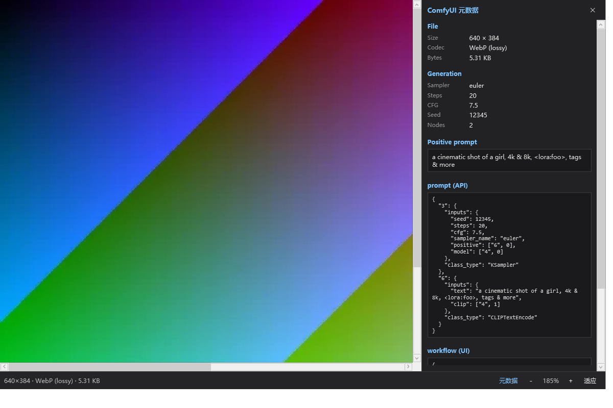
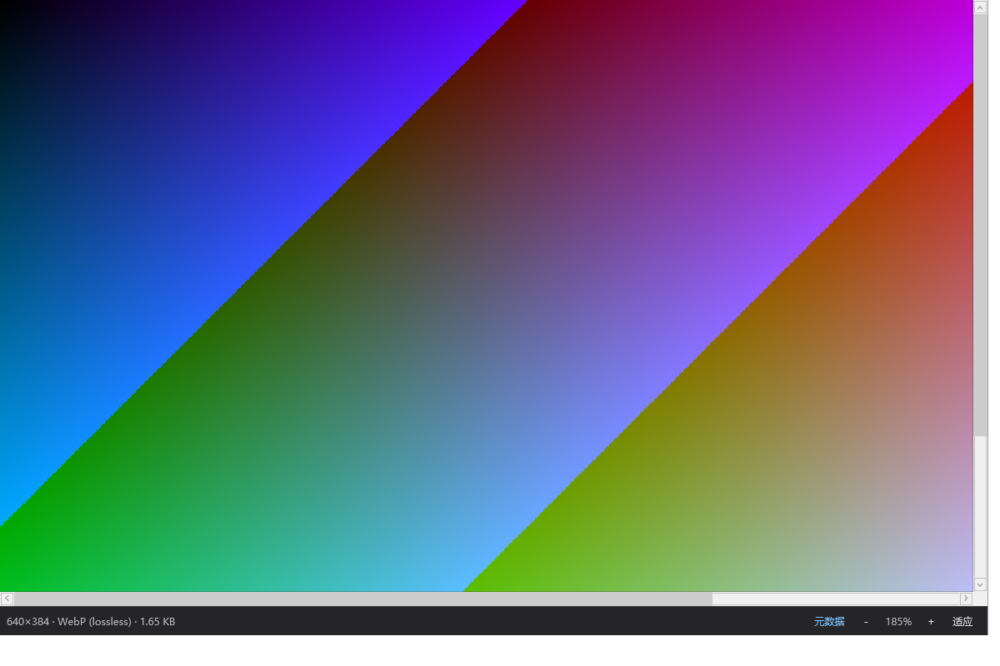
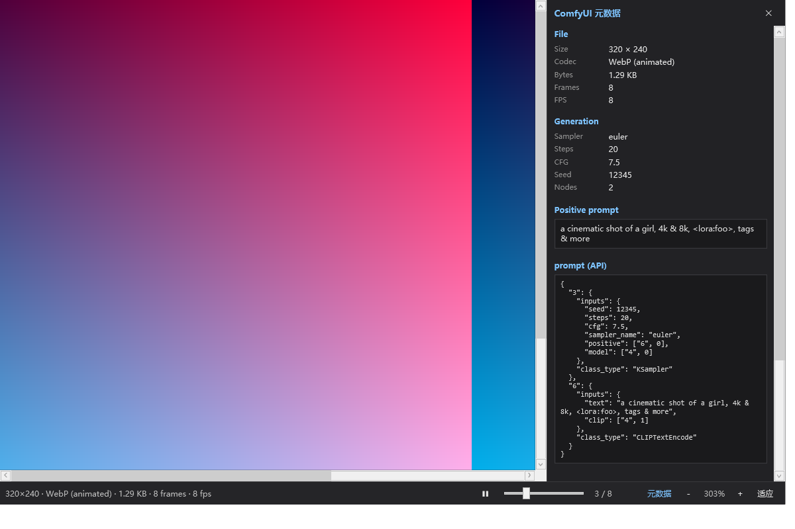

# ComfyWebpViewer

A QuickLook plugin that correctly previews WebP images generated by ComfyUI and reads the embedded prompt / workflow metadata.

## Background

QuickLook's built-in **ImageViewer** previews ComfyUI-generated `.webp` files by reading EXIF through exiv2 and feeding the output straight into `XmlDocument.LoadXml()`.

ComfyUI writes the prompt and workflow JSON into EXIF tags (`0x0110` / `0x010F`). Those JSON blobs routinely contain raw `&`, `<lora:...>` and similar characters, which makes the XML parser throw an exception → `Prepare()` fails → the preview window closes immediately.

This plugin bypasses exiv2 entirely: it parses the WebP RIFF container and EXIF chunk itself, decodes pixels through the Windows Imaging Component (WIC), and uses a hand-written JSON parser to extract generation parameters.

## Features

- Supports **static lossy / static lossless / animated WebP**
- Automatically detects and parses **ComfyUI prompt / workflow** metadata
- Metadata drawer (right side) shows: Sampler, Steps, CFG, Seed, Nodes, positive/negative prompts, full prompt API JSON, workflow UI JSON
- Correct fit on high-DPI / non-96-DPI WebP — no cropping, no stretching
- Mouse interactions: wheel zoom, Ctrl + wheel fast zoom, drag to pan, double-click to toggle fit / 100%
- Does not steal keyboard focus, so arrow keys still switch files in Explorer
- Only takes over `.webp` when ComfyUI metadata is detected; plain WebP is unaffected

## Quick Start

### Requirements

- Windows 10 / 11
- [.NET Framework 4.6.2 runtime](https://dotnet.microsoft.com/download/dotnet-framework/net462) installed
- Build tooling: Visual Studio 2019+ or the `dotnet build` CLI

### Build & Deploy

```powershell
cd src\QuickLook.Plugin.ComfyWebpViewer
dotnet build -c Release
```

After the build, `QuickLook.Plugin.ComfyWebpViewer.dll` and `Translations.config` are copied automatically by the `DeployPlugin` target to:

```
QuickLook.Plugin\QuickLook.Plugin.ComfyWebpViewer\
```

> **Note**: QuickLook locks loaded DLLs. Exit QuickLook before upgrading, then restart it.

## Project Structure

| File | Purpose |
| --- | --- |
| `Plugin.cs` | QuickLook plugin entry point, implements `IViewer` |
| `ImagePanel.xaml` / `.xaml.cs` | Preview UI: dark checkerboard background, zoom/pan, animation controls, metadata drawer |
| `WebpDecoder.cs` | Decodes WebP via WIC; normalizes frames to 96 DPI to avoid DIP-size distortion |
| `WebpFile.cs` | Hand-parses RIFF / VP8X / VP8 / VP8L / ANIM / ANMF / EXIF / XMP |
| `ComfyMetadata.cs` | Walks the JSON link graph to recover generation parameters |
| `Json.cs` | Minimal JSON parser |
| `Translations.config` | Localized strings (en / zh-CN / zh-TW) |
| `samples/` | Test fixtures and screenshots, see [samples/README.md](samples/README.md) |

## How It Works

### 1. Container Parsing

`WebpFile.cs` walks RIFF chunks per the spec to locate the `EXIF` chunk. Pillow-written EXIF carries a 6-byte `Exif\0\0` prefix, which is stripped here; the `ANIM` loop count is parsed as 16-bit.

### 2. Metadata Extraction

The EXIF chunk holds UTF-8 text:

- `prompt:{...}` — ComfyUI's prompt API JSON
- `workflow:{...}` — workflow UI JSON

`Json.cs` parses it minimally; `ComfyMetadata.cs` follows the prompt's link graph (e.g. `["6",0]`) to find `CLIPTextEncode` nodes and extract the positive/negative prompts and `KSampler` parameters.

### 3. Decoding & DPI Fix

The WIC decoder reports `BitmapSource.Width/Height` based on the DPI embedded in the WebP. ComfyUI output is commonly 72 DPI, which makes WPF treat the natural size as `PixelWidth / 72 * 96` and clip the image.

`WebpDecoder.NormalizeDpi()` converts each frame to `Bgra32` via `FormatConvertedBitmap`, then writes it into a 96-DPI `WriteableBitmap` so the DIP size equals the pixel size — fit and zoom are then fully correct.

## Mouse & Keyboard

| Action | Effect |
| --- | --- |
| Wheel | Zoom centered on cursor |
| Ctrl + Wheel | Fast zoom |
| Drag with left button | Pan the image |
| Double-click | Toggle fit ↔ 100% |
| Click "Fit" | Fit the image fully into the window |
| Arrow keys ↑↓←→ | Switch files in Explorer (focus stays in Explorer) |

## Configuration

By default the plugin **only takes over `.webp` files that contain ComfyUI metadata**. To handle all WebP files, create a config file:

Path: `%LOCALAPPDATA%\QuickLook\QuickLook.Plugin.ComfyWebpViewer.config`

Contents:

```xml
<?xml version="1.0" encoding="utf-8"?>
<Settings>
  <HandleAllWebP>True</HandleAllWebP>
</Settings>
```

## Known Issues & Troubleshooting

| Symptom | Cause | Resolution |
| --- | --- | --- |
| Preview window crashes/closes | ImageViewer's exiv2 → XML parse broken by ComfyUI metadata | Bypassed by this plugin |
| Image still clipped after fit, scrollbars present | WebP embeds 72 DPI, DIP size ≠ pixel size | Normalized to 96 DPI in `WebpDecoder` |
| Arrow keys can't switch files | Plugin captured keyboard focus | Removed the `Focus()` call |
| Animated WebP shows only one frame | Playing frame index is 0 | Auto-loops; drag the frame slider or pause |

## Screenshots

### Static lossy WebP (metadata drawer open)



### Static lossless WebP (default preview)



### Animated WebP (metadata drawer open)



## Test Cases

The project ships a set of minimal test files covering static lossy/lossless, animated, no-metadata, and real ComfyUI output scenarios. See [samples/README.md](samples/README.md).
